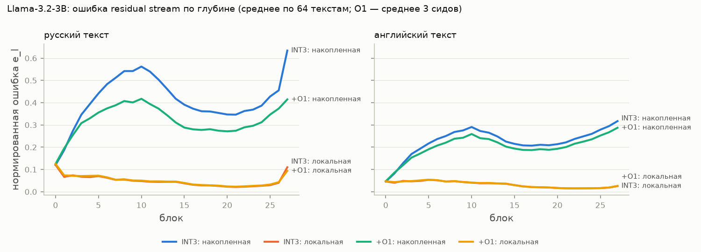
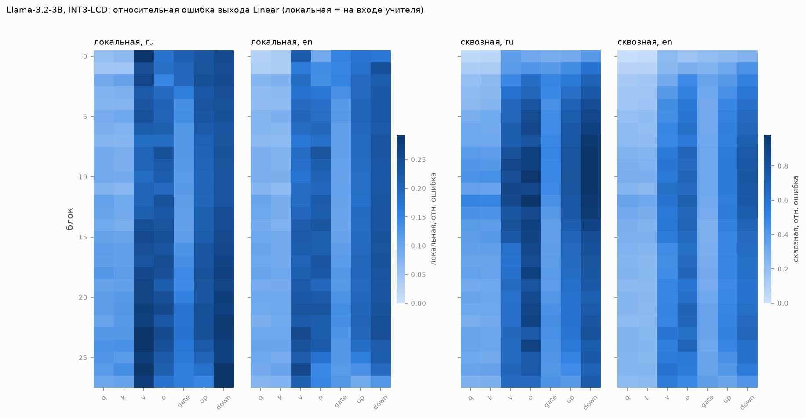

# lcd-ru: language-conditional corrections for 3-bit GPTQ LLMs in Russian

**What do language-conditional low-rank corrections actually repair in a GPTQ-W3 model, and why does accuracy not come
back with perplexity?**

[](requirements.txt)
[](LICENSE)
[](https://arxiv.org/abs/2608.11786)
[](#status-and-next-steps)

This repository studies **LCD** (Language-Conditional Dequantization, [arXiv:2608.11786](https://arxiv.org/abs/2608.11786)),
which attaches a per-language rank-2 correction to every linear layer of an already-quantized model. LCD trains these
corrections with a plain language-modelling loss. The project replicates LCD on Russian, diagnoses where the 3-bit
quantization error lives and what the corrections change, and then compares training objectives that target the
teacher's behaviour and representations: logit KD, hidden-state matching, and blockwise reconstruction with error
propagation.

> **Status.** Phases 0–2 of 5 are complete: infrastructure, an LCD replication on two models with three seeds, and the
> diagnostics. The alternative objectives (O2–O5) are implemented and unit-tested, but the phase 3 comparison at the
> 3B scale has **not been run yet**. Every result below concerns LCD's own objective (O1). The detailed reports are
> in Russian; this README summarizes them in English and cites each number's source.

## TL;DR

- **The LCD baseline is reproduced closely.** Russian perplexity recovery (R_ppl) is 56.8% for Qwen2.5-3B and 71.2%
  for Llama-3.2-3B, against 57.0% and 71.7% in the paper. Russian Global-MMLU gap recovery is 24.3% and 26.9%,
  against 25.3% and 26.1%. Seed spread is at most ±0.8 pp
  ([phase1.md](reports/phase1.md), [phase1_tables.md](reports/phase1_tables.md)).
- **Perplexity recovers about twice as much as accuracy.** In cross-entropy space, O1 closes 47.6% (Qwen) and 61.4%
  (Llama) of the Russian gap. It closes only 24.3% and 26.9% of the Russian MMLU gap, and only 19.8% and 34.6% of
  the teacher–student KL on the A–D answer distribution
  ([phase1_tables.md](reports/phase1_tables.md)).
- **The quantization error is mostly *propagated*, and O1 compensates for it rather than repairing layers.** On
  Russian text, a block's own (local) error is only 7–28% of the accumulated residual-stream error. O1 leaves the
  local error of every linear layer unchanged (−0.7% for Qwen, −1.4% for Llama). It lowers the accumulated error by
  16% and 22%. LCD's depth profiles ("Llama is damaged early, Qwen late") come from the end-to-end metric and do not
  appear in the local error ([phase2.md](reports/phase2.md)).
- **The MMLU damage and repair are mostly shared across languages.** The *Russian* correction lifts English MMLU
  almost as much as Russian MMLU: +5.2 vs +5.9 points for Qwen, +3.0 vs +3.6 for Llama. Per question, it raises
  log p(correct) at least as much on English as on Russian. INT3 damage is correlated across the parallel ru/en items
  (r = 0.44 and 0.25, against a permutation null of |r| ≈ 0.02)
  ([phase1.md](reports/phase1.md), [c3_tables.md](reports/c3_tables.md)).
- **Perplexity and accuracy can rank two INT3 models in opposite orders.** Re-quantizing Qwen2.5-3B with the same
  recipe, using our GPTQ or llm-compressor 0.14, gives a *better* Russian perplexity ratio than the author's
  checkpoint (INT3/FP16 1.765 vs 2.100) but *worse* MMLU (ru dev 26.3 vs 30.2, en dev 37.8 vs 41.3). The group
  scales are identical; 18% of the integer codes differ ([phase2.md §4](reports/phase2.md)).

## Background

**GPTQ-W3.** GPTQ quantizes weights one layer at a time, using second-order information from calibration activations.
At 3 bits per weight (W3A16, group size 128), 3B-parameter models lose a large share of their quality. Because the
calibration data is usually English (C4), non-English languages are hit harder. In LCD's setting, the INT3/FP16
perplexity ratio is 2.10–2.39 on Russian against 1.36–1.52 on English
([phase1_tables.md](reports/phase1_tables.md)).

**LCD.** LCD adds a per-language low-rank term to every linear layer inside the transformer blocks. Embeddings and
`lm_head` are left out, and the language is chosen at inference time:

```
y = W_q x + (1/r) · A_lang · B_lang · x,      A ∈ R^{d_out×r} (init 0),  B ∈ R^{r×d_in} (init N(0, 0.01²))
```

At rank 2 this adds 3.74M parameters per language for Qwen2.5-3B and 3.04M for Llama-3.2-3B. The corrections are
trained for 500 steps with a next-token loss on 256 documents. LCD reports large perplexity recovery but much smaller
accuracy recovery. It attributes the gap to *where* the damage sits: errors in early layers (Llama) propagate and
resist local correction, while errors in late layers (Qwen) do not.

**Why Russian.** Russian uses a non-Latin script, is under-represented in English calibration data, and has parallel
evaluation resources. Global-MMLU has en/ru items that share a `sample_id`, and RuBLiMP covers Russian grammar. These
make it possible to separate *shared* knowledge damage from *language-specific* damage. LCD's layer-wise analysis does
not include Russian.

## Method

### Training objectives (all at an equal budget: rank 2, all layers, the same 256 documents)

Notation: T is the bf16 teacher, S the quantized student with corrections, and `h_l` the residual stream after block
`l`. The normalized hidden-state error is `e_l = mean_t ‖h_l^S − h_l^T‖² / ‖h_l^T‖²`, computed over positions that
exclude the first token and massive-activation outliers.

| ID | Objective | Loss | Status |
|---|---|---|---|
| O1 | LCD-LM (replication) | next-token CE on mC4 ru; LCD hyperparameters (AdamW, lr 5e-4, cosine, 10% warmup, wd 0.01, clip 1.0, 500 steps) | trained and evaluated at 3B, 3 seeds |
| O2 | KD-logits | `mean_t KL(p^T ‖ p^S)`, T = 1 | implemented, unit-tested |
| O3 | End-to-end hidden states | `KL + λ · mean_l w_l e_l (+ μ · CE)` | implemented; 0.5B smoke run |
| O4-α | Blockwise with error propagation | block `l` sees the student input `X_l` and targets `α·h_l^T + (1−α)·Block_l^T(X_l)`, α ∈ {0, ½, 1} | target implemented; loop planned (phase 3) |
| O4+ | O4-α followed by a short O2 | ~100 KD steps end to end | planned |
| O5 | RILQ-style | `0.5·e_L + 0.5·CE` | implemented, unit-tested |

**Baselines and controls** (see [PLAN.md §4.1](PLAN.md), in Russian):

- **B1** EoRA-ru: training-free SVD in the activation basis.
- **B2** GPTQ calibrated on Russian.
- **C1** cross-lingual corrections: an English correction evaluated on Russian, and vice versa.
- **C2** O1 trained on the unquantized model, a domain-fit control.
- **C3** decomposition of the MMLU gap into shared and Russian-only parts over parallel items. C3 is done for O1;
  the others are planned.

### Metrics

- **Recovery ratios:** `R_acc` (Global-MMLU accuracy gap), `R_CE` (gap in log-perplexity, the primary perplexity
  metric), and `R_ppl` (perplexity space, used only for comparison with LCD, since it overstates recovery).
- **`R_KL`:** the reduction of `KL(p^T_ABCD ‖ p^S_ABCD)` on the A–D answer distribution. The phase 3 decision rule
  is fixed in advance: ΔR_KL(dev) ≥ 5 pp over O1, with a 95% bootstrap CI above 0. Measured on the 2000-question
  dev split, R_KL is about 10× more sensitive than accuracy ([phase1.md §5](reports/phase1.md)).
- **Error decomposition:**
  - accumulated error `e_acc`: the student runs end to end;
  - local error `e_locT`: the student's block gets the teacher's input;
  - per-linear-layer error, measured both end to end (LCD's metric) and locally.
- **Other metrics:** RuBLiMP minimal pairs, teacher KL and top-1 agreement on held-out text, and paired bootstrap
  tests over items plus per-subject t-tests, as in LCD.

## Experimental setup

| | |
|---|---|
| **Models** | `Qwen/Qwen2.5-3B`; `unsloth/Llama-3.2-3B`, whose weights are byte-identical to `meta-llama/Llama-3.2-3B` (verified SHA256 and tokenization on 1176 texts; [CHANGELOG](reports/CHANGELOG.md)); `Qwen/Qwen2.5-0.5B` for the pipeline smoke test |
| **Quantized bases** | **INT3-LCD**, the author's public checkpoints `nrmlthms/{qwen2.5,llama3.2}-3b-int3-gptq`, dequantized to bf16 and used for all main experiments. **INT3-ours**, our fake-quant GPTQ, and llm-compressor 0.14, both used as cross-checks. Settings follow LCD's code: W3A16, group size 128, symmetric, no act-order, damp 0.01, 128 × 512 tokens of C4 en, `lm_head` not quantized |
| **Teacher** | the same model in bf16 ("FP16" is only the condition name, as in LCD) |
| **Training data** | mC4 ru (via `allenai/c4`), 256 documents selected with LCD's loader (seed 45), 512 tokens, 1 document per step |
| **Perplexity** | LCD protocol (256 train-stream docs, seed 42) for the replication; clean protocol (mC4 ru validation shards, 256 docs) in-domain; Wikipedia ru and Gazeta out of domain; C4 en |
| **Downstream** | Global-MMLU ru/en, 0-shot, with LCD's prompt and scorer (ru n = 14,041). The Russian set is split **before any evaluation** into dev (2000, stratified over 57 subjects) and final-test (12,041) |
| **Grammar** | RuBLiMP, 45 phenomena × 1000 pairs |
| **Seeds** | 0, 1, 2 for O1. The seed sets the initialization of B; document order is fixed, as in LCD |
| **Splits** | declared up front in [`data/splits/`](data/splits) (document URLs + SHA1, MMLU `sample_id`s, RuBLiMP row indices); the LCD-protocol perplexity documents share 0 URLs with the training and calibration documents |
| **Compute** | Google Colab GPUs: L4 for phases 0–1 and A100 for phase 2. All conditions in one comparison run on the same GPU type. Code, job queue, and artifacts travel through private Kaggle datasets. Cost: phase 1 ≈ 5.3 L4-hours, phase 2 ≈ 25 A100-minutes |
| **Software** | transformers 5.17.0, datasets 5.0.1, compressed-tensors 0.19.0, llmcompressor 0.14.0; Colab torch 2.11 + CUDA 12.8 ([requirements.txt](requirements.txt)) |

## Results

### 1. LCD replication (LCD protocol, INT3-LCD base; O1 is the mean ± SD over 3 seeds)

| | Qwen FP16 | Qwen INT3 | Qwen +O1 | Llama FP16 | Llama INT3 | Llama +O1 |
|---|---|---|---|---|---|---|
| ppl ru: ours | 6.15 | 12.91 | 9.07 ± 0.00 | 8.25 | 19.69 | 11.54 ± 0.02 |
| ppl ru: paper | 5.90 | 12.51 | 8.74 | 7.74 | 18.46 | 10.77 |
| Global-MMLU ru: ours | 53.89 | 29.71 | 35.58 ± 0.14 | 44.49 | 31.20 | 34.78 ± 0.11 |
| Global-MMLU ru: paper | 53.88 | 29.64 | 35.77 | 44.37 | 31.24 | 34.67 |
| Global-MMLU en: ours | 64.80 | 41.67 | 46.90 ± 0.17\* | 55.45 | 39.94 | 42.90 ± 0.05\* |

\* The Russian correction was evaluated on English questions (a cross-lingual control). With the correction switched
off, all six O1 runs reproduce the INT3 logits bit for bit.

The INT3/FP16 perplexity ratios match the paper within 1% on Russian. Absolute FP16 perplexities differ by 3–12%
because the streamed document sample differs between `datasets` versions. The English ratio for Llama differs by 8.9%
on the LCD protocol and 1.9% on the clean protocol, which is consistent with sampling variance
([phase1.md §3](reports/phase1.md)). Every O1 vs INT3 difference on Russian MMLU is significant. For seed 0 the gain
is +5.96 points, 95% CI [5.13, 6.82] (Qwen), and +3.70, CI [2.86, 4.52] (Llama).

### 2. Perplexity vs accuracy recovery for O1 (Russian, 3 seeds)

| | Qwen2.5-3B | Llama-3.2-3B |
|---|---|---|
| R_ppl, LCD protocol | 56.8% | 71.2% |
| R_CE, LCD protocol / clean in-domain | 47.6% / 47.1% | 61.4% / 60.9% |
| R_CE, Wikipedia ru / Gazeta (OOD) | 40.3% / 47.3% | 50.0% / 57.8% |
| R_KL, held-out text (val_ru_64) | 33.2% | 47.7% |
| R_KL, Global-MMLU A–D (dev) | 19.8% | 34.6% |
| **R_acc, Global-MMLU ru (full)** | **24.3%** | **26.9%** |
| RuBLiMP (FP16 → INT3 → O1) | 0.889 → 0.871 → 0.897 | 0.929 → 0.855 → 0.895 |

Source: [phase1_tables.md](reports/phase1_tables.md). On Qwen, O1 scores *above* the FP16 teacher on RuBLiMP.

### 3. Where the quantization error lives (phase 2)

Values are means over the early / middle / late thirds of the blocks, on 64 Russian validation documents. "Share
propagated" is 1 − local/accumulated.

| Model | Condition | Accumulated `e_acc` | Local `e_locT` | Share propagated |
|---|---|---|---|---|
| Qwen2.5-3B | INT3 | 0.157 / 0.228 / 0.252 | 0.035 / 0.015 / 0.024 | 0.74 / 0.93 / 0.91 |
| Qwen2.5-3B | +O1 | 0.144 / 0.185 / 0.204 | 0.035 / 0.016 / 0.024 | 0.73 / 0.92 / 0.88 |
| Llama-3.2-3B | INT3 | 0.366 / 0.461 / 0.404 | 0.071 / 0.042 / 0.035 | 0.72 / 0.91 / 0.92 |
| Llama-3.2-3B | +O1 | 0.304 / 0.343 / 0.313 | 0.073 / 0.043 / 0.035 | 0.69 / 0.87 / 0.89 |

Language asymmetry: the local per-linear error is only 1.17–1.20× larger on Russian than on English, but the
accumulated `e_l` is 1.83–2.19× larger. The Russian-specific gap appears *during propagation*, not in individual
layers. Sources: [phase2.md](reports/phase2.md) and [phase2_tables.md](reports/phase2_tables.md).

<p align="center">
  
</p>

*Llama-3.2-3B: normalized residual-stream error by block, Russian text (left) and English text (right). Legend
terms: накопленная = accumulated, локальная = local. O1 (green) tracks INT3 for the first ~5 blocks and then
suppresses accumulation; it leaves the local error (orange/red) unchanged. Labels are in Russian. Qwen2.5-3B:
[`p2_qwen3b_el.png`](reports/figs/p2_qwen3b_el.png).*

<p align="center">
  
</p>

*Llama-3.2-3B, INT3-LCD: relative output error per linear layer. Left pair: local error (input from the teacher).
Right pair: end-to-end error (сквозная), LCD's metric. The end-to-end view reproduces LCD's "worst `down_proj` /
`o_proj` in blocks 8–13". The local view is nearly flat over depth; its worst layers are `v_proj` (blocks 0, 23–27)
and late `down_proj`. Qwen2.5-3B: [`p2_qwen3b_heatmap.png`](reports/figs/p2_qwen3b_heatmap.png), whose worst local
layers are the early `down_proj` in blocks 2–9.*

### 4. Shared vs language-specific MMLU damage (C3, 14,041 parallel items)

| | Qwen2.5-3B | Llama-3.2-3B |
|---|---|---|
| Mean damage Δ log p(correct), INT3 − FP16: ru / en | −0.372 / −0.423 | −0.226 / −0.350 |
| Mean repair by the **ru** correction: ru / en | +0.073 / **+0.080** | +0.077 / **+0.091** |
| corr(damage ru, damage en) per item (null \|r\|₉₉) | 0.442 (0.020) | 0.254 (0.022) |
| corr(repair ru, repair en) | 0.214 | 0.113 |
| O1 recovers shared-lost / ru-only-lost items | 24.6% / 38.9% | 29.0% / 35.5% |

Discrete "lost item" counts are dominated by answer flips near the decision threshold: the shared losses are only
1.08–1.09× what independence predicts. For this reason C3 uses the continuous log p(correct). Correcting INT3's bias
toward the letter "A" leaves O1's gain unchanged (+5.8 points for Qwen, +3.9 for Llama). Sources:
[c3_tables.md](reports/c3_tables.md) and [phase2.md §3](reports/phase2.md).

### 5. Two INT3 models, opposite rankings (Qwen2.5-3B)

| INT3 variant | Codes equal to the author's | Scales equal | INT3/FP16 ppl ru | INT3/FP16 ppl en | MMLU ru dev | MMLU en dev |
|---|---|---|---|---|---|---|
| llm-compressor 0.14 (QAC on) | 82.4% | 100% | 1.765 | 1.363 | 26.3 | 37.8 |
| llm-compressor 0.14 (QAC off) | 82.5% | 100% | 1.765 | 1.368 | 26.2 | 35.5 |
| Our GPTQ (INT3-ours) | 82.4% | 100% | 1.791 | 1.383 | 25.5 | 28.8 |
| **Author's checkpoint (INT3-LCD)** | 100% | 100% | 2.100 | 1.355 | **30.2** | **41.3** |

A modern GPTQ toolchain with LCD's recipe reproduces our GPTQ, not the author's checkpoint. The author's checkpoint
was most likely produced by an older llm-compressor; its config was saved under transformers 4.47.1. Among models
built from one architecture and one recipe, the model that is better on Russian perplexity is worse on MMLU in both
languages ([phase2.md §4](reports/phase2.md), [phase1.md §4](reports/phase1.md)).

## Reproduce

### Local: CPU unit tests (no GPU needed)

```bash
uv venv --python 3.12 .venv
uv pip install --python .venv/bin/python torch --index-url https://download.pytorch.org/whl/cpu
uv pip install --python .venv/bin/python -r requirements.txt
.venv/bin/python -m pytest              # 33 tests on tiny random-weight Qwen2/Llama models, ~40 s
.venv/bin/python -m pytest -m network   # our data loader selects exactly LCD's documents (streams C4)
```

A Hugging Face read token in the environment (`HF_TOKEN`) is recommended, because streaming mC4/C4 anonymously hits
rate limits. It is read from the environment only and never stored in the repository.

### GPU runs: Colab worker with a Kaggle-dataset job queue

All GPU work runs on Colab through a polling worker. Code, the job queue, status, and artifacts are stored as
**private Kaggle datasets** (`<user>/lcd-ru-code`, `lcd-ru-jobs`, `lcd-ru-data`, `lcd-ru-runs-<run>`).

> The defaults in `colab/jobs.py`, `colab/worker.py`, `colab/artifacts.py` and the notebook cell point to the
> author's Kaggle account. To use your own, set `KAGGLE_USERNAME`, pass `--user <you>` to `colab/jobs.py`, and edit
> the dataset owner in `colab/worker.ipynb`.

```bash
# 1. Build the split texts from the committed split files, then upload them as the `data` artifact
.venv/bin/python scripts/make_splits.py                     # writes data/texts/*.jsonl (Gazeta texts are never stored)
LCDRU_TEXTS=data/texts .venv/bin/python colab/artifacts.py save data

# 2. Package the committed tree (writes GIT_HASH; every result record carries it)
bash kaggle/push_code.sh

# 3. Open colab/worker.ipynb in Colab (L4 or A100; T4 is refused because it lacks bf16).
#    Secrets: KAGGLE_API_TOKEN, HF_TOKEN. Run the single cell and leave the tab open.

# 4. Queue jobs locally and collect results
.venv/bin/python colab/jobs.py add --id p1-llama3b-o1-s0 --gpu --timeout-h 3 --save runs/p1_llama3b_o1_s0 \
    --results '$LCDRU_RUNS/p1_llama3b_o1_s0/*.jsonl' '$LCDRU_RUNS/p1_llama3b_o1_s0/*.jsonl.gz' \
    --cmd "python scripts/train.py --config configs/p1/llama3b.yaml name=p1_llama3b_o1_s0 seed=0 eval.cond=o1_s0"
.venv/bin/python colab/jobs.py wait --id p1-llama3b-o1-s0
```

The job commands used for the reported results (substitute `qwen3b` for `llama3b`, and seeds 0/1/2 for O1):

| Phase | Command run on the worker |
|---|---|
| 0, smoke (0.5B) | `python scripts/smoke.py --config configs/p0_smoke.yaml` |
| 1, FP16 | `python scripts/evaluate.py --config configs/p1/llama3b.yaml name=p1_llama3b_fp16 base.kind=fp16 eval.cond=fp16` |
| 1, INT3-LCD | `python scripts/evaluate.py --config configs/p1/llama3b.yaml name=p1_llama3b_int3lcd base.kind=lcd-int3 eval.cond=int3lcd` |
| 1, O1 | `python scripts/train.py --config configs/p1/llama3b.yaml name=p1_llama3b_o1_s0 seed=0 eval.cond=o1_s0` |
| 1, INT3-ours | `python scripts/compare_int3.py --config configs/p1/llama3b.yaml name=p1_llama3b_int3ours && python scripts/evaluate.py --config configs/p1/llama3b_int3ours.yaml name=p1_llama3b_int3ours eval.cond=int3ours` |
| 2, diagnostics | `python scripts/diagnose.py --config configs/p2/llama3b_diag.yaml name=p2_llama3b_diag` (restores the phase 1 corrections) |
| 2, llm-compressor | `python scripts/quantize_llmc.py --config configs/p2/qwen3b_llmc.yaml name=p2_qwen3b_llmc_qac llmc.name=int3llmc-qwen3b-qac llmc.qac=true`, then `compare_int3.py` and `evaluate.py` with `base.path=$LCDRU_RUNS/int3llmc-qwen3b-qac` |

Tables and figures are regenerated locally with `scripts/analyze_phase1.py`, `scripts/analyze_phase2.py` (both accept
`--no-sync`) and `scripts/analyze_c3.py`. The aggregate run records are in [`results/`](results) (`phase{0,1,2}.jsonl`,
append-only, each with its git hash, config, environment, and GPU time). The per-question MMLU log-probs (41 MB, in
`results/items/`) are not included in the repository. C3, the A–D R_KL, and the bootstrap CIs need them.

## Repository structure

```
├── src/
│   ├── corrections.py      CorrectedLinear: per-language rank-r A·B in fp32; install / switch / save / load
│   ├── quant/gptq.py       fake-quant GPTQ (INT3-ours), after IST-DASLab/gptq, ported to transformers 5.x
│   ├── models.py           FP16 / INT3-LCD (author's checkpoints, decoded by hand) / INT3-ours bases
│   ├── objectives.py       O1, O2, O3, O5 losses and the O4-α blockwise target; hidden-state capture
│   ├── train.py            LCD's training loop with checkpoints, resume, SIGTERM handling
│   ├── data.py             LCD-identical document streams, hash-selected clean splits, split files
│   ├── pipeline.py         glue between configs and the CLI scripts
│   └── eval/               perplexity, KL / e_l / per-linear error, Global-MMLU, RuBLiMP, diagnostics, statistics
├── scripts/                CLIs: make_splits, quantize, quantize_llmc, train, evaluate, diagnose, compare_int3,
│                           smoke, collect_results, analyze_phase1/2, analyze_c3
├── configs/                one YAML per experiment (p0_*, p1/, p2/), with `inherit:` and key=value overrides
├── tests/                  CPU unit tests on tiny random-weight models (+ one network test)
├── colab/                  worker.ipynb + worker.py (Colab), jobs.py (local queue), artifacts.py, session_setup.sh
├── kaggle/                 push_code.sh (committed tree → private Kaggle dataset), kutil.py
├── data/splits/            fixed splits: document URLs + SHA1, MMLU sample_ids, RuBLiMP rows (no texts)
├── results/                append-only run records (jsonl) and summaries
├── reports/                phase reports, tables, figures, plan review, changelog (in Russian)
├── ref/lcd/                LCD reference code (Apache-2.0) and INT3 checkpoint metadata; not imported
└── PLAN.md                 phase-gated research plan v2 (in Russian)
```

Documents, all in Russian: [PLAN.md](PLAN.md) (hypotheses H1–H5, protocol, phases);
[plan_review.md](reports/plan_review.md) (the pre-registration review that shaped plan v2);
[CHANGELOG.md](reports/CHANGELOG.md) (every protocol decision and why);
phase reports [0](reports/phase0.md), [1](reports/phase1.md), [2](reports/phase2.md).

## Status and next steps

**Limitations.**

- Only LCD's own objective (O1) has been evaluated at the 3B scale. Whether KD, hidden-state, or blockwise objectives
  recover more accuracy (H1) is still open.
- All main experiments use the author's INT3 checkpoints. These cannot be regenerated with current tooling (§5 above),
  so conclusions are conditional on one specific INT3 model per architecture.
- The results cover two 3B base models at W3 and Russian only, with the language given by an oracle at inference.
- O1's seed variance is tiny (the seed only changes the initialization of B). Between-seed agreement understates
  variance from data selection: the English ratio for Llama moves by 7% between two samples of 256 documents.
- Phase 0–2 MMLU numbers on the full set include the dev split. The final-test split is reserved for phase 4.

**Next (phase 3 pilot, Llama-3.2-3B first):**

1. Compare O2, O3, O4-α (α ∈ {0, ½, 1}), and O5 against O1 on MMLU dev, using the pre-registered R_KL rule.
2. Add the cross-lingual control C1. An *English* correction that repairs Russian MMLU as well as the Russian one does
   would show that language conditioning matters for perplexity but not for knowledge.
3. Run B1 (EoRA-ru), B2 (Russian-calibrated GPTQ via llm-compressor 0.14), and the C2 domain-fit control.

Phases 4–5 cover full runs on final-test with 3 seeds, ablations of rank, placement, and data size, W4, and the
write-up.

## Citation

This work builds on LCD. Please cite the original paper:

```bibtex
@misc{thomas2026lcd,
  title         = {Language-Conditional Dequantization: Recovering What Quantization Steals from Non-English Languages},
  author        = {Thomas, Nirmal},
  year          = {2026},
  eprint        = {2608.11786},
  archivePrefix = {arXiv},
  url           = {https://arxiv.org/abs/2608.11786}
}
```

To cite this repository:

```bibtex
@software{nojokes2026lcdru,
  author = {NoJokes},
  title  = {lcd-ru: Language-conditional low-rank corrections for GPTQ-W3 LLMs in Russian},
  year   = {2026},
  url    = {https://github.com/kholkink/lcd-ru}
}
```

## License

The code in this repository is released under the [MIT License](LICENSE).

- `ref/lcd/code/` is the unmodified LCD reference code under Apache-2.0 (see its [LICENSE](ref/lcd/code/LICENSE)).
- `src/quant/gptq.py` follows the algorithm of [IST-DASLab/gptq](https://github.com/IST-DASLab/gptq) (Apache-2.0).
- The LCD paper (CC BY 4.0) is linked, not redistributed.
- Model weights are not included. Qwen2.5-3B is under the Qwen Research License; Llama 3.2 is under the Llama 3.2
  Community License ("Built with Llama").
- No dataset texts are redistributed: `data/splits/` holds only document URLs, hashes, and item indices. Gazeta is
  for non-commercial personal use only and is never stored; Wikipedia is CC BY-SA. See each dataset card for its
  terms.
