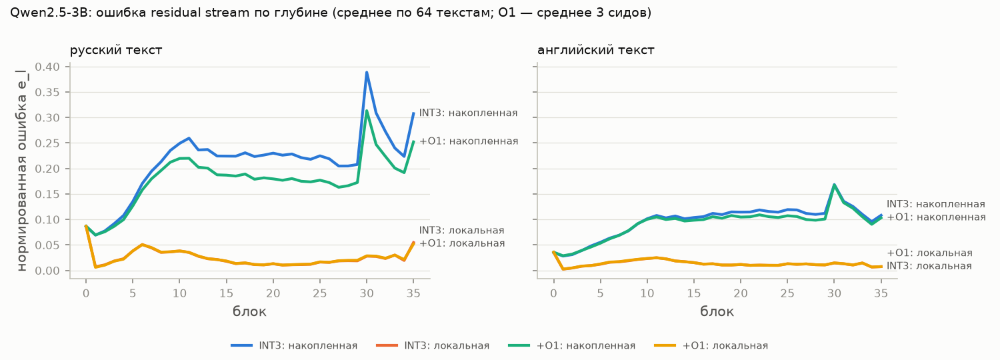
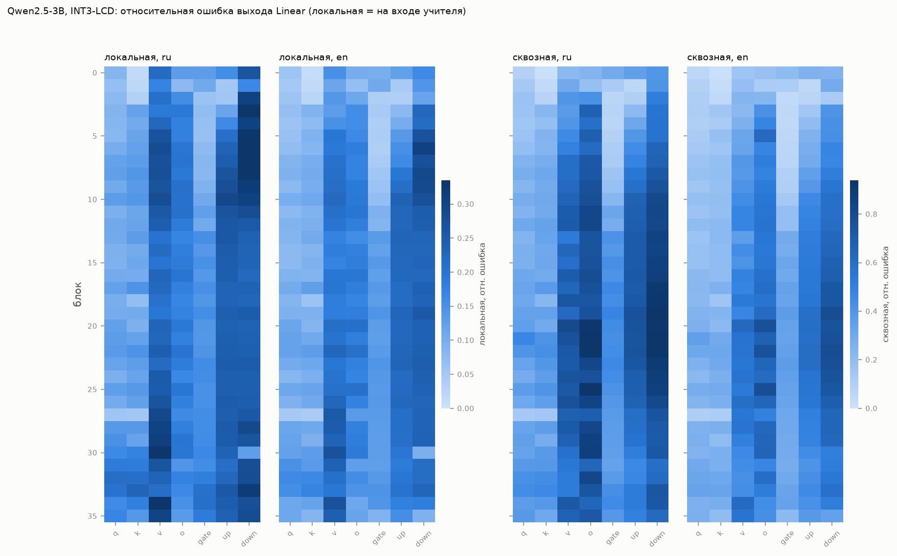

# Фаза 2 — таблицы (scripts/analyze_phase2.py)

## Qwen2.5-3B (36 блоков)

Средние по третям глубины (ранние / средние / поздние блоки). Доля распространённой = 1 − локальная/накопленная.

| Текст | Условие | e_acc | e_locT (вход учителя) | e_locS (вход студента) | доля распространённой |
|---|---|---|---|---|---|
| val_ru_64 | INT3 | 0.157 / 0.228 / 0.252 | 0.035 / 0.015 / 0.024 | 0.035 / 0.017 / 0.021 | 0.74 / 0.93 / 0.91 |
| val_ru_64 | +O1 (3 сида) | 0.144 / 0.185 / 0.204 | 0.035 / 0.016 / 0.024 | 0.032 / 0.014 / 0.021 | 0.73 / 0.92 / 0.88 |
| ppl_en_256 | INT3 | 0.062 / 0.110 / 0.119 | 0.016 / 0.013 / 0.011 | 0.016 / 0.014 / 0.011 | 0.73 / 0.88 / 0.90 |
| ppl_en_256 | +O1 (3 сида) | 0.062 / 0.103 / 0.111 | 0.016 / 0.013 / 0.011 | 0.016 / 0.012 / 0.011 | 0.72 / 0.87 / 0.90 |

Снижение e_acc поправкой O1 (ru), по третям: 7% / 19% / 19%; в последнем блоке 18%.

Худшие Linear по локальной ошибке (val_ru_64): 6.down_proj 0.40, 7.down_proj 0.37, 3.down_proj 0.37, 8.down_proj 0.36, 5.down_proj 0.35, 34.v_proj 0.33
Худшие по сквозной (val_ru_64): 25.o_proj 1.00, 22.o_proj 0.98, 21.down_proj 0.97, 19.down_proj 0.96, 22.down_proj 0.94, 21.o_proj 0.94

Худшие Linear по локальной ошибке (ppl_en_256): 6.down_proj 0.31, 8.down_proj 0.29, 9.down_proj 0.29, 7.down_proj 0.27, 10.down_proj 0.27, 34.v_proj 0.27
Худшие по сквозной (ppl_en_256): 19.down_proj 0.79, 22.down_proj 0.79, 25.o_proj 0.78, 23.down_proj 0.77, 21.down_proj 0.77, 20.o_proj 0.77

## Llama-3.2-3B (28 блоков)

Средние по третям глубины (ранние / средние / поздние блоки). Доля распространённой = 1 − локальная/накопленная.

| Текст | Условие | e_acc | e_locT (вход учителя) | e_locS (вход студента) | доля распространённой |
|---|---|---|---|---|---|
| val_ru_64 | INT3 | 0.366 / 0.461 / 0.404 | 0.071 / 0.042 / 0.035 | 0.074 / 0.046 / 0.038 | 0.72 / 0.91 / 0.92 |
| val_ru_64 | +O1 (3 сида) | 0.304 / 0.343 / 0.313 | 0.073 / 0.043 / 0.035 | 0.067 / 0.039 / 0.029 | 0.69 / 0.87 / 0.89 |
| ppl_en_256 | INT3 | 0.177 / 0.245 / 0.249 | 0.048 / 0.034 / 0.018 | 0.049 / 0.036 / 0.016 | 0.64 / 0.86 / 0.93 |
| ppl_en_256 | +O1 (3 сида) | 0.159 / 0.219 / 0.226 | 0.048 / 0.035 / 0.018 | 0.046 / 0.032 / 0.016 | 0.62 / 0.84 / 0.92 |

Снижение e_acc поправкой O1 (ru), по третям: 13% / 26% / 22%; в последнем блоке 35%.

Худшие Linear по локальной ошибке (val_ru_64): 0.v_proj 0.38, 27.down_proj 0.37, 26.v_proj 0.30, 23.v_proj 0.30, 26.down_proj 0.29, 24.v_proj 0.29
Худшие по сквозной (val_ru_64): 12.o_proj 1.00, 11.down_proj 1.00, 9.down_proj 0.99, 10.down_proj 0.99, 8.down_proj 0.98, 10.o_proj 0.97

Худшие Linear по локальной ошибке (ppl_en_256): 26.v_proj 0.25, 23.v_proj 0.25, 23.down_proj 0.24, 22.down_proj 0.24, 1.down_proj 0.24, 17.down_proj 0.24
Худшие по сквозной (ppl_en_256): 10.down_proj 0.76, 11.down_proj 0.76, 9.down_proj 0.75, 12.down_proj 0.75, 8.down_proj 0.74, 13.down_proj 0.73

## llm-compressor против чекпоинта автора (Qwen2.5-3B)

| Вариант | коды = автор | скейлы = автор | INT3/FP16 ppl ru (LCD) | INT3/FP16 ppl en (LCD) | MMLU ru dev | MMLU en dev |
|---|---|---|---|---|---|---|
| llm-compressor 0.14, qac=True | 82.4% | 100.0% | 1.765 | 1.363 | 26.25 | 37.75 |
| llm-compressor 0.14, qac=False | 82.5% | 100.0% | 1.765 | 1.368 | 26.15 | 35.50 |
| INT3-LCD (автор) | 100% | 100% | 2.100 | 1.355 | 30.20 | 41.30 |